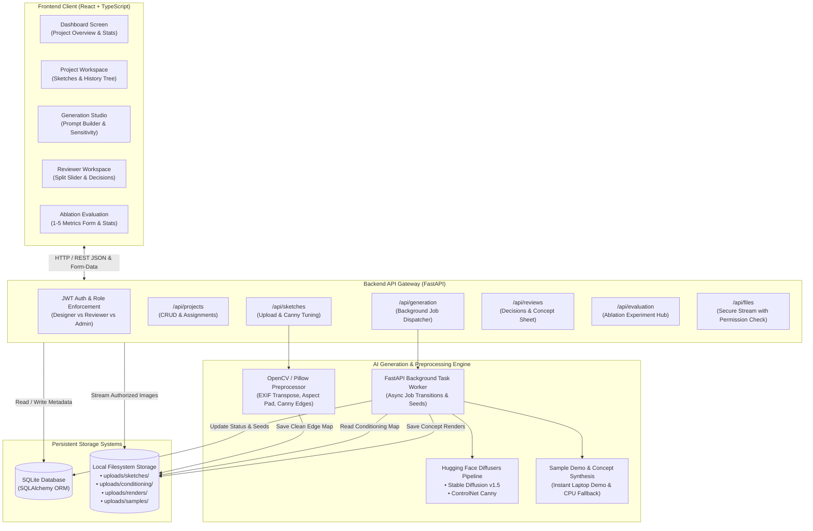

# Sketch2Park — System Architecture Documentation

## System Architecture Diagram

## Architectural Highlights

### 1. Separation of Concerns
- **Frontend (`frontend/`)**: React 18 with TypeScript and Vite. Modular state management with AuthContext, API client module, and dedicated workspaces for designers and reviewers.
- **Backend API (`backend/app/`)**: FastAPI application organized into discrete routers (`routers/`), models (`models.py`), schemas (`schemas.py`), services (`services/`), and configuration (`config.py`).
- **Inference Engine (`backend/app/services/generator.py`)**: Hugging Face Diffusers pipeline manager separated from core application logic. Detects hardware (CUDA, MPS, CPU) and supports two operating modes:
  1. **AI Generation**: Full ControlNet Canny + Stable Diffusion 1.5 pipeline.
  2. **Sample Demo**: Instant pre-rendered concept suite allowing demonstration and grading on standard student laptops without a dedicated GPU.

### 2. Multi-Role Permission Enforcement
- Backend validates permissions on every request:
  - Designers can create projects, upload sketches, generate concepts, and author revisions.
  - Reviewers can view assigned projects, inspect submitted renders, record formal decisions (`approved`, `changes_requested`, `rejected`), and leave feedback comments.
  - Image downloads and streaming (`/api/files/{category}/{filename}`) check project ownership and reviewer assignment to prevent unauthorized asset access.

### 3. Spatial ControlNet Conditioning
- Sketches are uploaded as JPG or PNG (including smartphone photos of paper drawings).
- PIL corrects EXIF orientation and standardizes dimensions (512x512) preserving aspect ratio.
- OpenCV extracts Canny edge maps with adjustable low and high sensitivity thresholds.
- Spatial lines act as spatial conditioning guides so roller coaster loops, stations, and tracks remain locked in place while the diffusion model renders materials, lighting, and atmosphere.

### 4. Version Revision & Approval Lineage
- If a reviewer requests changes, the designer spawns a revision request referencing the original render ID (`source_render_id`).
- All previous renders, comments, and review decisions are permanently archived.
- Approving an older version never approves a newer version, and approving a newer version preserves historical review decisions on older drafts.
